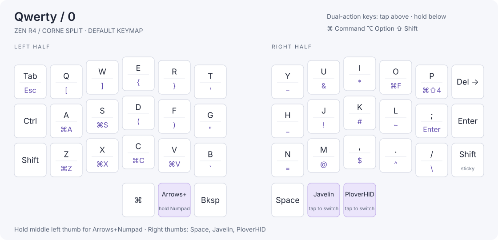
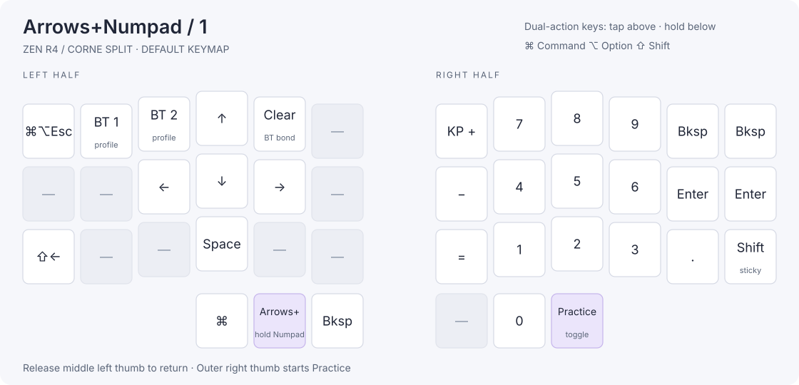
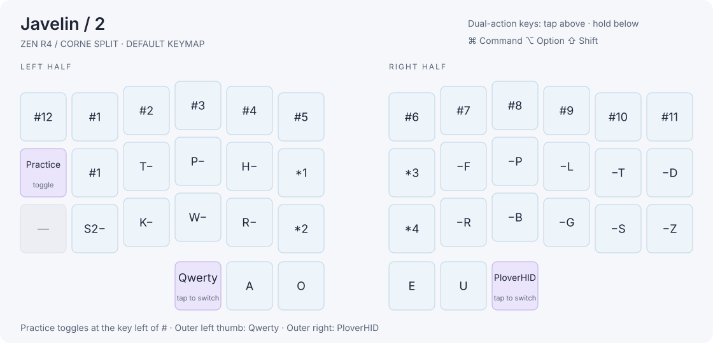
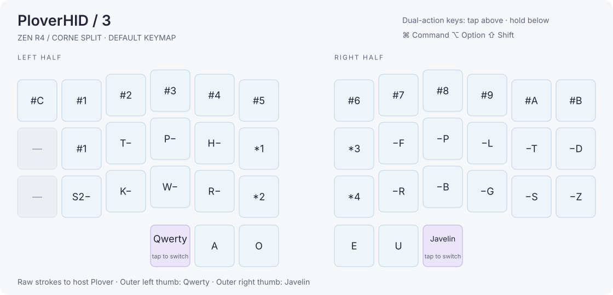

# ZMK + Javelin Steno

ZMK keyboard firmware with onboard Javelin translation, Plover HID, wireless dictionary editing, and offline steno practice.

The tested keyboard pairs a handwired Zen R4 left half with a Corne Ultralight right half, both using nice!nano v2 controllers. The halves communicate over Bluetooth. The left half connects to the computer over USB or Bluetooth and reads dictionaries from a 16 MiB W25Q128 QSPI flash chip. The right half drives a portrait nice!view display.

ZMK handles the keyboard, Bluetooth, power management, and keymap editing. Javelin handles onboard steno translation. The external flash integration includes dictionary provisioning, verified readback, memory-mapped lookups, and persistent personal entries. [ZMK](https://github.com/zmkfirmware/zmk) · [Javelin](https://github.com/jthlim/javelin-steno)

## Keyboard modes and controls

| Mode | Output |
| --- | --- |
| **Qwerty** | Ordinary keyboard input through ZMK. |
| **Arrows+Numpad** | Arrow keys, a number pad, and Bluetooth controls. Hold the middle left thumb to use it. |
| **Javelin** | Onboard dictionary translation, including spelling rules, repeat, and undo. Works with Plover closed. |
| **PloverHID** | Raw steno strokes sent to Plover on the computer, using Plover's dictionaries. |

In Qwerty, the right thumbs are **Space**, **Javelin**, and **PloverHID**, from left to right. The outer left thumb returns to Qwerty from either steno mode. In a steno mode, the outer right thumb switches to the other steno mode.

In onboard Javelin, the upper left S position is the Lapwing **#** key; the lower position stays **S**. Pressing **#** by itself repeats the preceding translation, and star undoes it.

The typing layout uses tap/hold keys and macOS Command shortcuts. Customize bindings through ZMK Studio. [Shared keymap](config/corne.keymap) · [Split keymap](config/zen-r4-split/corne.keymap)

## Onboard dictionaries

| Dictionary | Default |
| --- | --- |
| Personal dictionary (`user_dictionary`) | On |
| Lapwing Commands | On |
| Lapwing Numbers | On |
| Lapwing UK Additions | Off |
| Lapwing Proper Nouns | On |
| Lapwing Base | On |
| Plover Base | Off |

Personal entries have highest priority, followed by the Lapwing extras in the order above, Lapwing Base, and Plover Base. Selections and personal edits survive reboot and firmware updates.

Enable Plover Base and disable Lapwing Base to switch bases. The extras have independent checkboxes, so disable those too if you want only Plover's base plus your personal entries. With every dictionary disabled, Javelin outputs literal outlines such as `KAT`.

The compiled base and extras images occupy about 4.13 MiB of external flash. Personal entries have 16 KiB of entry data, backed by two CRC-checked snapshots. Initial dictionary installation uses the left half's diagnostics serial port. [Provisioning and flash layout](config/zen-r4-split/README.md#flash-regions-and-initial-plover-provisioning)

## Wireless dictionary editing

1. Connect the left half by USB, or pair **Zen R4 Split** with the computer for Bluetooth access.
2. Open Javelin Steno Tools in Chrome, choose **Connect via HID**, and select the keyboard.
3. Use **Active Dictionaries** to change selections and **Dictionary Management → View** to add, replace, remove, or export personal entries.
4. Use **Host Layout** to select **Mac U.S.** or **Windows U.S. (plain text)**. The keyboard remembers the choice.

Mac U.S. supports accents using the U.S./ABC input source. Windows U.S. uses ordinary U.S. keystrokes and converts accented Latin letters to plain equivalents, such as **ç → c**. Wireless editing has been verified on macOS. Full base images are installed through serial provisioning. [Javelin Steno Tools](https://lim.au/#/software/javelin-steno-tools)

## ZMK Studio

ZMK Studio edits the keymap over Bluetooth. The **left-studio** build also supports Studio over USB and starts unlocked.

Tap/hold bindings display their tap keys. Javelin and Plover HID bindings have separate parameters for the visible key label and the actual steno key. Change the steno identity to change what a key sends.

Saved Studio keymaps take precedence over the source keymap. To load updated defaults, use **Restore stock settings**, which replaces saved keymap edits. Renamed layers appear on the nice!view after a layer change, with up to nine characters sent across the split. [Studio](https://zmk.studio/) · [Binding details](config/zen-r4-split/README.md#studio-key-labels)

## Portrait nice!view and squid

The right half renders a **68 × 160** portrait interface with bold text, mode names, a rounded battery indicator, and its own battery percentage.

The squid reacts to right-hand typing with a short puff that finishes before another keypress can trigger it. It greets the left half with **Hi** after reconnection, shows a static sleep bubble while idle on battery, and celebrates completed Practice runs with confetti. USB power adds a repeating bob, blink, and rising sparkles. Upper effects hide when the mode label needs that space.

Sprites live in the right controller's internal flash, and animations run locally. The USB effect indicates external power, including when the battery is full. [Display implementation and memory use](config/zen-r4-split/README.md#right-half-niceview)

## Offline Practice

Hold the middle left thumb for Arrows+Numpad, tap the outer right thumb, then release both.

| Drill | Prompts | Checks |
| --- | ---: | --- |
| WORDS | 10 | CAT, THE, IF, and IS through the onboard dictionary engine. |
| LEFT | 50 | Random left-hand consonant keys. |
| RIGHT | 50 | Random right-hand consonant keys. |

The hand drills use Steno Jig's key sets and draw a new random prompt after each correct answer. Consecutive repeats are allowed. Mistakes keep the current prompt and reset the streak; correct answers advance after 250 ms.

Tap a left star by itself for the previous drill, or a right star for the next. The key immediately left of the Lapwing # key toggles Practice. The outer left thumb returns to Qwerty.

Practice works with the computer off and consumes its strokes before host output. Hand drills work with dictionaries disabled; WORDS can use the verified Lapwing Base as a fallback. Saved dictionary selections stay intact. [Practice guide](config/zen-r4-split/README.md#offline-practice) · [Steno Jig](https://joshuagrams.github.io/steno-jig/learn-keyboard.html)

## Bluetooth and power

From Qwerty, hold Arrows+Numpad and tap **Q** for Bluetooth profile 0 or **W** for profile 1. Tap **R** on that layer to clear the selected profile's host pairing. Pair **Zen R4 Split** in the computer's Bluetooth settings. USB is normally preferred while connected.

Typing, onboard Javelin, Plover HID, and dictionary editing have been verified over Bluetooth on macOS. The Windows plain-text output profile has been tested on Windows; Windows Bluetooth remains unverified.

Both halves enable deep sleep after 15 idle minutes on battery. Wake each half with one of its own keys. The left half switches off the external flash rail during deep sleep and also after 30 seconds outside Javelin/Practice without dictionary use. Entering Javelin or accessing the editor wakes the flash. Boot checks verify the installed images before translation starts.

Battery logging is available as an optional build feature. [Battery logger](tools/zen-r4-battery/README.md) · [Power settings](config/zen-r4-split/corne_left.conf)

## Build and install

GitHub Actions builds these UF2 artifacts from the pinned dependencies:

| Artifact | Use |
| --- | --- |
| **left-studio** | Everyday left-half firmware with Studio over USB and Bluetooth. |
| **left-logging** | Left-half firmware with the serial port used for dictionary installation and diagnostics. |
| **right-nice-view** | Right-half firmware with the portrait display, squid, and Practice UI. |
| **right** | Right-half firmware without the display. |

Download artifacts from a successful run. Double-tap RESET on the intended controller and copy its UF2 to the **NICENANO** drive. Install matching left and right firmware when updating Practice or split-display features. [Firmware builds](https://github.com/disarmyouwitha/zmk-javelin-steno/actions/workflows/build.yml)

For a new keyboard, prepare the dictionary images using the build guides, flash **left-logging**, and install them through its diagnostics port using Python with the `pyserial` package. Substitute the actual serial device path:

```sh
python3 tools/zen-r4-lapwing/upload.py /dev/cu.usbmodem14501
```

The uploader installs missing configured images from `build/`. Use `--status` to inspect them or `--verify` for a full CRC check. After provisioning, flash **left-studio** for everyday use. Dictionary images are uploaded separately from the UF2 firmware.

- [Split build, provisioning, and pairing guide](config/zen-r4-split/README.md)
- [Standalone left-half build and pinout](config/zen-r4-left/README.md)
- [Handwired left-half wiring diagram](config/zen-r4-left/zen_r4_left_wiring_diagram.png)
- [QSPI diagnostics](tools/zen-r4-qspi/README.md)

Local builds must use this checkout's west manifest. If the workspace keeps a separate manifest copy, synchronize it before running `west update`. The compiled dictionary format depends on the pinned Javelin engine. [Dependency manifest](config/west.yml)

## License

The Javelin steno engine is licensed under PolyForm Noncommercial 1.0.0. Dependencies and dictionary sources retain their respective licenses. [Javelin license](https://github.com/jthlim/javelin-steno/blob/22726675b2dcf3b8b6ba1e20898f25e324b2260a/LICENSE.txt)

## Visual keymap

These diagrams show the default split keymap. Tap actions appear above the
divider and hold actions below. Transparent keys show the inherited Qwerty
action. Number-bar and star suffixes identify physical keys; all number-bar
keys contribute the same **#** stroke. Keymaps saved in Studio may differ.

### Qwerty



### Arrows+Numpad



### Javelin



### PloverHID



Regenerate the diagrams after editing the shared or split keymap:

```sh
python3 scripts/render_keymap.py
```
