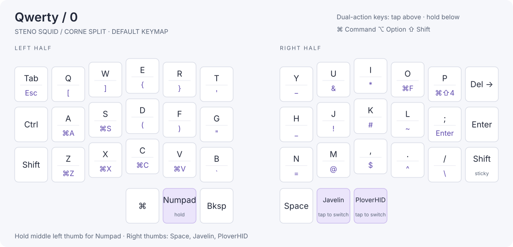
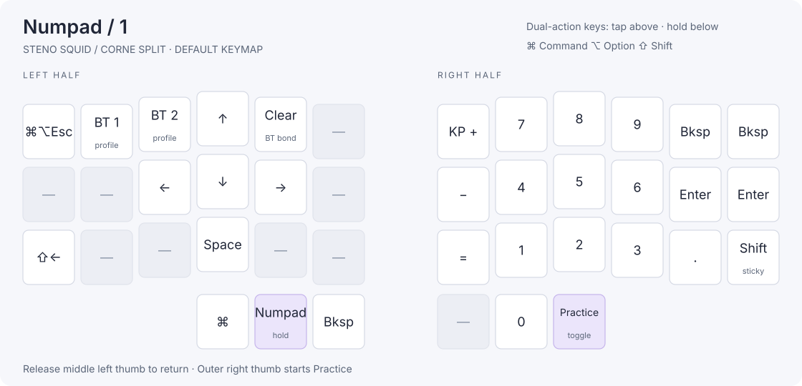
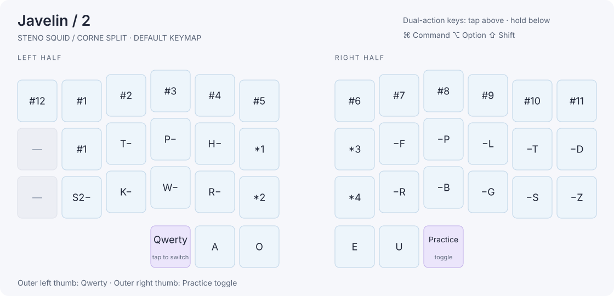
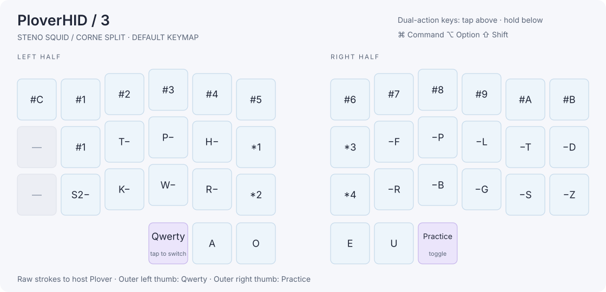

# Steno Squid

ZMK keyboard firmware with onboard Javelin translation, Plover HID, wireless dictionary editing, and offline steno practice.

The tested keyboard pairs a handwired Steno Squid left half with a Corne Ultralight right half, both using nice!nano v2 controllers. The halves communicate over Bluetooth. The left half connects to the computer over USB or Bluetooth and reads dictionaries from a 16 MiB W25Q128 QSPI flash chip. The right half drives a portrait nice!view display.

ZMK handles the keyboard, Bluetooth, power management, and keymap editing. Javelin handles onboard steno translation. The external flash integration includes dictionary provisioning, verified readback, memory-mapped lookups, and persistent personal entries. [ZMK](https://github.com/zmkfirmware/zmk) · [Javelin](https://github.com/jthlim/javelin-steno)

The `steno-squid/locked-pin-map` branch also targets the Boardsource Wireless
Corne SMT with the locked Steno Squid expansion pinout. This hardware port is
awaiting on-device bring-up. [Boardsource build and pinout](config/boardsource-wireless-corne/README.md)

## Keyboard modes and controls

| Mode | Output |
| --- | --- |
| **Qwerty** | Ordinary keyboard input through ZMK. |
| **Numpad** | Arrow keys, a number pad, and Bluetooth controls. Hold the middle left thumb to use it. |
| **Javelin** | Onboard dictionary translation, including spelling rules, repeat, and undo. Works with Plover closed. |
| **PloverHID** | Raw steno strokes sent to Plover on the computer, using Plover's dictionaries. |

In Qwerty, the right thumbs are **Space**, **Javelin**, and **PloverHID**, from left to right. The outer left thumb returns to Qwerty from either steno mode. The outer right thumb starts Practice from Numpad, Javelin, or PloverHID and toggles it off again to ordinary Javelin. To switch steno modes, return to Qwerty and select the desired mode.

In onboard Javelin, the upper left S position is the Lapwing **#** key; the lower position stays **S**. Pressing **#** by itself repeats the preceding translation, and star undoes it.

The typing layout uses tap/hold keys and macOS Command shortcuts. Customize bindings through ZMK Studio. [Shared keymap](config/corne.keymap) · [Split keymap](config/steno-squid-split/corne.keymap)

## Onboard dictionaries

| Dictionary | Default |
| --- | --- |
| Personal dictionary (`user_dictionary`) | On |
| Lapwing Commands | On |
| Lapwing Numbers | On |
| Lapwing UK Additions | Off |
| Lapwing Proper Nouns | On |
| Lapwing Base | On |
| Plover Base | Off |

Personal entries have highest priority, followed by the Lapwing extras in the order above, Lapwing Base, and Plover Base. Selections and personal edits survive reboot and firmware updates.

Enable Plover Base and disable Lapwing Base to switch bases. The extras have independent checkboxes, so disable those too if you want only Plover's base plus your personal entries. With every dictionary disabled, Javelin outputs literal outlines such as `KAT`.

The compiled base and extras images occupy about 4.13 MiB of external flash. Personal entries have 16 KiB of entry data, backed by two CRC-checked snapshots. Initial dictionary installation uses the left half's diagnostics serial port. [Provisioning and flash layout](config/steno-squid-split/README.md#flash-regions-and-initial-plover-provisioning)

## Wireless dictionary editing

1. Connect the left half by USB, or pair **Steno Squid** with the computer for Bluetooth access.
2. Open Javelin Steno Tools in Chrome, choose **Connect via HID**, and select the keyboard.
3. Use **Active Dictionaries** to change selections and **Dictionary Management → View** to add, replace, remove, or export personal entries.
4. Use **Host Layout** to select **Mac U.S.** or **Windows U.S. (plain text)**. The keyboard remembers the choice.

Mac U.S. supports accents using the U.S./ABC input source. Windows U.S. uses ordinary U.S. keystrokes and converts accented Latin letters to plain equivalents, such as **ç → c**. Wireless editing has been verified on macOS. Full base images are installed through serial provisioning. [Javelin Steno Tools](https://lim.au/#/software/javelin-steno-tools)

## ZMK Studio

ZMK Studio edits the keymap over Bluetooth. The **left-studio** build also supports Studio over USB and starts unlocked.

Tap/hold bindings display their tap keys. Javelin and Plover HID bindings have separate parameters for the visible key label and the actual steno key. Change the steno identity to change what a key sends.

Saved Studio keymaps take precedence over the source keymap. To load updated defaults, use **Restore stock settings**, which replaces saved keymap edits. Renamed layers appear on the nice!view after a layer change. Only the first nine characters are sent across the split, and only plain ASCII: any other character, such as an accented letter, shows as `?`. [Studio](https://zmk.studio/) · [Binding details](config/steno-squid-split/README.md#studio-key-labels)

## Portrait nice!view and squid

The right half renders a **68 × 160** portrait interface with bold text, mode names, a rounded battery indicator, and its own battery percentage.

Pop, the 48 × 48 squid traced from the original concept, reacts to right-hand typing with a short puff that finishes before another keypress can trigger it. Layer changes play a separate 320 ms card-flip above the squid. Typing and battery updates do not restart it. It greets the left half with **Hi** after reconnection, shows a static sleep bubble while idle on battery, and celebrates completed Practice runs with confetti. USB power adds a repeating bob, blink, and rising sparkles. Upper effects hide when the mode label needs that space.

The right display shows **Discon-** above Pop and **-nected** below when the left half has neither a connected Bluetooth host on the active profile nor a USB HID connection. **Waiting for Left** means the halves themselves are disconnected.

On the Javelin layer the display shows the last **translation and stroke above Pop**, in larger bold text. The translation can span multiple strokes; the stroke row shows the most recent stroke, not the complete outline. The hint or WPM appears below the layer name. The display appears with the first stroke and hides on other layers, in Practice, and while a host-disconnection notice is showing. Translations are limited to twelve characters; text that cannot fit ends in "..". WPM counts the last ten seconds of translated characters and updates with strokes. [Split message format](src/steno_squid/stroke_feed.h)

The trial config enables **shorter-outline hints**. Our dictionary compiler adds a compact, sorted flash index of one-stroke shortcuts, searched without copying the dictionary into RAM. For example, Lapwing's `HE/HROE` translates to **hello**, and can suggest `H-L`. This first index suggests one-stroke shortcuts; it does not index alternative multi-stroke briefs. Personal dictionaries retain their engine-native reverse lookup. Only enabled dictionaries participate, and a shortcut overridden by a higher-priority dictionary is excluded.

These are **build-time settings**, not browser settings. Replace the existing values in the indicated config files:

| Setting | Config file | Purpose |
| --- | --- | --- |
| `CONFIG_ZMK_STENO_SQUID_STROKE_HINT` | [corne_left.conf](config/steno-squid-split/corne_left.conf) | Enable or disable shortcut lookup on the left half. |
| `CONFIG_ZMK_STENO_SQUID_STROKE_TRANSLATION` | [right-nice-view.conf](config/steno-squid-split/right-nice-view.conf) | Show or hide the stroke, translation, and WPM on the right display. This does not disable onboard Javelin translation. |

| Desired display | Left: `STROKE_HINT` | Right: `STROKE_TRANSLATION` |
| --- | --- | --- |
| Stroke/translation and hints (current defaults) | `y` | `y` |
| Stroke/translation, no hints | `n` | `y` |
| Hints only | `y` | `n` |
| Neither; upper space available for Pop's animations | `n` | `n` |

For example, to disable both:

```ini
# config/steno-squid-split/corne_left.conf
CONFIG_ZMK_STENO_SQUID_STROKE_HINT=n
```

```ini
# config/steno-squid-split/right-nice-view.conf
CONFIG_ZMK_STENO_SQUID_STROKE_TRANSLATION=n
```

Rebuild and flash the half whose config changed; changing both settings requires flashing both halves. With hints only, a hint uses the upper space when one exists, and animations resume when it clears. Connection notices and long layer labels can still use that space.

Leave `CONFIG_ZMK_STENO_SQUID_STROKE_TAPE=y` on both halves for the combinations above. To remove stroke reporting entirely, set it to `n` on both halves as well as disabling both options above. Layer status, Practice, and onboard translation remain separate features. Switching these display options does not require reinstalling dictionary images.

The new index changes dictionary image sizes and checksums. When upgrading from images without it, rebuild and reinstall **all three images** through **left-logging** using `upload.py PORT --repair --base lapwing` (then `--base plover` and `--base extras`), then return to **left-studio**. The personal dictionary and saved dictionary selections live separately. Old images remain forward-compatible with the dictionary format, but have no base-dictionary shortcut hints. Logging builds with hints enabled report `[tape] stroke handled in N us`; this includes engine translation and hint work on the key-handling thread.

Sprites live in the right controller's internal flash, and animations run locally. The USB effect indicates external power, including when the battery is full. [Display implementation and memory use](config/steno-squid-split/README.md#right-half-niceview)

## Offline Practice

Hold the middle left thumb for Numpad, tap the outer right thumb, then release both.

| Drill | Prompts | Checks |
| --- | ---: | --- |
| WORDS | 10 | CAT, THE, IF, and IS through the onboard dictionary engine. |
| LEFT | 50 | Random left-hand consonant keys. |
| RIGHT | 50 | Random right-hand consonant keys. |

Practice opens a Practice menu. Select WORDS, LEFT, or RIGHT with the left/right star keys, then tap a vowel thumb (A, O, E, or U) to start. After a run, tap a vowel thumb to return to the menu.

The hand drills use Steno Jig's key sets and draw a new random prompt after each correct answer. Consecutive repeats are allowed. Mistakes keep the current prompt and reset the streak; correct answers advance after 250 ms.

Tap a left star by itself for the previous drill, or a right star for the next. The outer right thumb toggles Practice; the former left-hand Practice key is unbound. The outer left thumb returns to Qwerty.

Practice works with the computer off and consumes its strokes before host output. Hand drills work with dictionaries disabled; WORDS can use the verified Lapwing Base as a fallback. Saved dictionary selections stay intact. [Practice guide](config/steno-squid-split/README.md#offline-practice) · [Steno Jig](https://joshuagrams.github.io/steno-jig/learn-keyboard.html)

## Bluetooth and power

From Qwerty, hold Numpad and tap **Q** for Bluetooth profile 0 or **W** for profile 1. Tap **R** on that layer to clear the selected profile's host pairing. Pair **Steno Squid** in the computer's Bluetooth settings. USB is normally preferred while connected.

Typing, onboard Javelin, Plover HID, and dictionary editing have been verified over Bluetooth on macOS. The Windows plain-text output profile has been tested on Windows; Windows Bluetooth remains unverified.

Both halves enable deep sleep after 15 idle minutes on battery. Wake each half with one of its own keys. The left half switches off the external flash rail during deep sleep and also after 30 seconds outside Javelin/Practice without dictionary use. Entering Javelin or accessing the editor wakes the flash. Boot checks verify the installed images before translation starts.

Battery logging is available as an optional build feature. [Battery logger](tools/steno-squid-battery/README.md) · [Power settings](config/steno-squid-split/corne_left.conf)

## Build and install

GitHub Actions builds these UF2 artifacts from the pinned dependencies:

| Artifact | Use |
| --- | --- |
| **left-studio** | Everyday left-half firmware with Studio over USB and Bluetooth. |
| **left-logging** | Left-half firmware with the serial port used for dictionary installation and diagnostics. |
| **right-nice-view** | Right-half firmware with the portrait display, squid, and Practice UI. |
| **right** | Right-half firmware without the display. |

This branch also builds **boardsource-left-studio**, **boardsource-left-logging**,
**boardsource-right**, **boardsource-probe**, and **boardsource-quad** for the
Boardsource hardware. Follow the linked bring-up guide for those targets.

Download artifacts from a successful run. Double-tap RESET on the intended controller and copy its UF2 to the **NICENANO** drive. Install matching left and right firmware when updating Practice or split-display features. [Firmware builds](https://github.com/disarmyouwitha/StenoSquid/actions/workflows/build.yml)

For a new keyboard, prepare the dictionary images using the build guides, flash **left-logging**, and install them through its diagnostics port using Python with the `pyserial` package. Substitute the actual serial device path:

```sh
python3 tools/steno-squid-lapwing/upload.py /dev/cu.usbmodem14501
```

The uploader installs missing configured images from `build/`. Use `--status` to inspect them or `--verify` for a full CRC check. After provisioning, flash **left-studio** for everyday use. Dictionary images are uploaded separately from the UF2 firmware.

- [Split build, provisioning, and pairing guide](config/steno-squid-split/README.md)
- [Standalone left-half build and pinout](config/steno-squid-left/README.md)
- [Handwired left-half wiring diagram](config/steno-squid-left/steno_squid_left_wiring_diagram.png)

Local builds must use this checkout's west manifest. If the workspace keeps a separate manifest copy, synchronize it before running `west update`. The compiled dictionary format depends on the pinned Javelin engine. [Dependency manifest](config/west.yml)

The `upload.py` tests run against a fake keyboard, with no hardware or pyserial: `python3 tools/steno-squid-lapwing/test_upload.py`. CI runs them on every push and posts each build's flash and RAM use on the run page.

## Planned work

### Daily-use features

- **Built, not run on hardware:** the stroke tape (last stroke, translation, WPM) and the hint behind `CONFIG_ZMK_STENO_SQUID_STROKE_HINT`. The engine reports strokes as console events, which the left half catches around each key event. Still to check on a board: how long a stroke takes with hints on, and the extra battery cost of the per-stroke writes.
- The typing animation listens for local right-half keypresses, not every stroke made on both halves. That is reasonable for the first version. The stroke tape now gives the central a way to report completed strokes, so the pet could react to actual translations in Javelin mode.

Keep the typing reaction exactly as it is for now. It is a major part of the charm.

### Battery

Once a board is running, use the diagnostics counters to settle the idle power-down default. If the right half's battery life is disappointing, optimize the pet in this order:

1. Cap battery-powered animation frequency, perhaps 4 to 5 FPS.
2. Shorten the typing animation from four frames to two or three.
3. Investigate partial-region flushing, but only if the Sharp driver and rotation adapter can support it cleanly.
4. Measure the right-half power draw with the pet enabled versus disabled.

## Debug and test code to remove or gate

These exist for bring-up and battery testing. Before calling the firmware finished, remove each one or put it behind a build flag.

| Item | Where | Current state |
| --- | --- | --- |
| `W` serial query: last flash check path and its time in milliseconds | `src/steno_squid/lapwing_flash.c` | Only in builds with `-S zmk-usb-logging` |
| Diagnostics: boot log kept across a soft reset, `S` status, `D` log dump, `Z` clear, `R` rail test, `T` power-cycle bench, fault counters saved in settings, wake timing, `upload.py --diag` | `src/steno_squid/diag.c`, `src/steno_squid/diag.h`, the `diag_*()` calls in `src/steno_squid/lapwing_flash.c` | Behind `CONFIG_ZMK_JAVELIN_DIAG`, default on, only in builds with `-S zmk-usb-logging`. To remove for good, delete the two files and the calls |
| Battery and activity logger, its `B` serial export and host script | `src/steno_squid/battery_log.c`, `tools/steno-squid-battery/` | Behind `CONFIG_ZMK_JAVELIN_BATTERY_LOG` |
| 128 KiB internal flash partition reserved for the battery log | `config/steno-squid-split/corne_left.overlay` | Always reserved, even with the logger off |
| Flash idle power-down experiment | `CONFIG_ZMK_JAVELIN_STENO_FLASH_IDLE_OFF` in `Kconfig`, `src/steno_squid/lapwing_flash.c` | On by default. Once battery testing settles it, remove the option or keep it as a plain setting |
| Start-up prints such as `[JAV] ...`, the JEDEC ID, flash check time and idle power-down | `src/engine_init.cc`, `src/steno_squid/lapwing_flash.c`, `src/steno_squid/lapwing_dictionary.cc` | Always compiled, visible only on the logging serial port |
| `CONFIG_STACK_SENTINEL` and `CONFIG_THREAD_NAME` | `config/steno-squid-split/corne_left.conf` | Always on |

Serial provisioning with `upload.py` is not on this list. It stays, and is already limited to builds with the logging snippet.

## License

The Javelin steno engine is licensed under PolyForm Noncommercial 1.0.0. Dependencies and dictionary sources retain their respective licenses. [Javelin license](https://github.com/jthlim/javelin-steno/blob/22726675b2dcf3b8b6ba1e20898f25e324b2260a/LICENSE.txt)

## Visual keymap

These diagrams show the default split keymap. Tap actions appear above the
divider and hold actions below. Transparent keys show the inherited Qwerty
action. Number-bar and star suffixes identify physical keys; all number-bar
keys contribute the same **#** stroke. Keymaps saved in Studio may differ.

### Qwerty



### Numpad



### Javelin



### PloverHID



Regenerate the diagrams after editing the shared or split keymap:

```sh
python3 scripts/render_keymap.py
```
