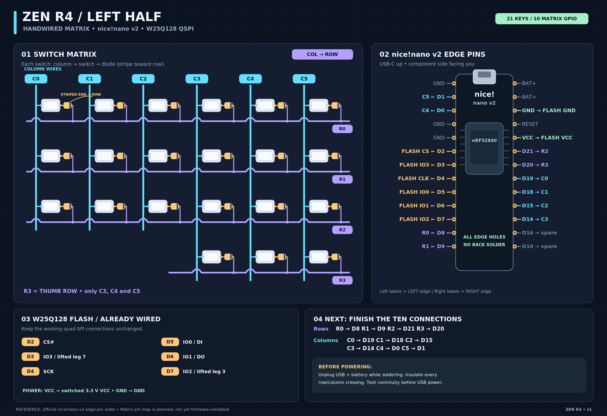

# Steno Squid handwired left half

This USB target uses the verified 21-switch left matrix and the breadboard QSPI pin map. It keeps normal ZMK typing, onboard Javelin and host Plover HID as separate modes. The right half and split transport are outside this test.

## Tested keymap

The [ZMK keymap](nice_nano.keymap) includes the matrix wiring, the layout and all four layers.

| Left thumb position | MAIN | Javelin or Plover HID |
| --- | --- | --- |
| Outer, R3C3 | Enter onboard Javelin | Return to MAIN |
| Middle, R3C4 | Enter host Plover HID steno | Steno A |
| Inner, R3C5 | Tap Backspace, hold SYM+NUM | Steno O |

Both steno layers use the same left-bank positions as the combined Corne configuration. For one-half testing, R1C0 is right-bank `-T` and R2C0 is `E`.

| Steno row | C0 | C1 | C2 | C3 | C4 | C5 |
| --- | --- | --- | --- | --- | --- | --- |
| R0 | Number | Number | Number | Number | Number | Number |
| R1 | -T | S | T | P | H | Star |
| R2 | E | S | K | W | R | Star |
| R3 |  |  |  | MAIN | A | O |

## Wiring diagram



The diagram was drawn before bring-up. The assembled left half has since passed [standalone matrix testing](../../tools/steno-squid-matrix/README.md) and the firmware tests below.

## Build and provision

The pinned [Lapwing base dictionary](https://github.com/aerickt/plover-lapwing-aio/blob/4ac5d53cf039a2b1f4c484456663c85e7df4e859/plover_lapwing/dictionaries/lapwing-base.json) has 114,885 outlines. It compiles to a 1,700,488-byte image with the pinned Javelin ABI. The host Plover plugins and optional dictionaries belong to the host mode.

Use the same pinned west workspace and Zephyr SDK as the combined Corne build. Run from the repository root and set `ws` to the workspace path.

```sh
repo="$PWD"
mkdir -p "$repo/build/lapwing"
curl --fail --location \
  https://raw.githubusercontent.com/aerickt/plover-lapwing-aio/4ac5d53cf039a2b1f4c484456663c85e7df4e859/plover_lapwing/dictionaries/lapwing-base.json \
  -o "$repo/build/lapwing/lapwing-base.json"
python3 tools/dict_compiler/compile_dict.py "$repo/build/lapwing/lapwing-base.json" \
  --base-addr 0x12000000 -o "$repo/build/lapwing/lapwing-base.bin"
export ZEPHYR_BASE="$ws/zephyr"
cd "$ws"
west build -s zmk/app -d "$repo/build/steno-squid-left" -b nice_nano//zmk -S zmk-usb-logging -- \
  "-DZMK_CONFIG=$repo/config/steno-squid-left" "-DZMK_EXTRA_MODULES=$repo" \
  "-DZMK_JAVELIN_LAPWING_IMAGE=$repo/build/lapwing/lapwing-base.bin" \
  "-DZephyr_DIR=$ZEPHYR_BASE/share/zephyr-package/cmake"
```

Copy `build/steno-squid-left/zephyr/zmk.uf2` onto the left nice!nano's `NICENANO` drive. After it enumerates as Steno Squid Left, run the uploader with Python and pyserial. Replace the serial device path with the current one.

```sh
python3 "$repo/tools/steno-squid-lapwing/upload.py" /dev/cu.usbmodem14501 \
  --base lapwing "$repo/build/lapwing/lapwing-base.bin"
```

The uploader checks for conflicting existing bits before programming, verifies each programmed chunk by readback, and checks the entire image again through quad memory-mapped reads. The firmware also checks native one- and two-stroke lookups. On a later boot it verifies the existing image and opens it automatically. Use `--status` to query status without writing. The uploader can retry an interrupted upload of the same image. It has no erase command.

## Physical USB checks

In a text editor with Plover closed, enter Javelin with the outer thumb. Chord `TP / -T / KAT / S / -T / KAT` to type “if the cat is the cat.” For `KAT`, use R2C2, the middle thumb and R1C0. Test `HE / HROE` for “hello” from a two-stroke entry. Both strokes use R2C0 for E. Return to typing with the outer thumb. Enter Plover HID with the middle thumb and check the raw strokes in host Plover.

## Hardware results

The left half booted as Steno Squid Left with keyboard and Plover HID USB interfaces. The full image passed per-chunk flash readback and a CRC check over all 1,700,488 memory-mapped bytes. Native Javelin lookups returned `if`, `cat`, and `hello` from `TP`, `KAT`, and `HE/HROE`.

The builder confirmed ordinary typing, host Plover HID steno, and onboard Javelin steno on the assembled left half.
